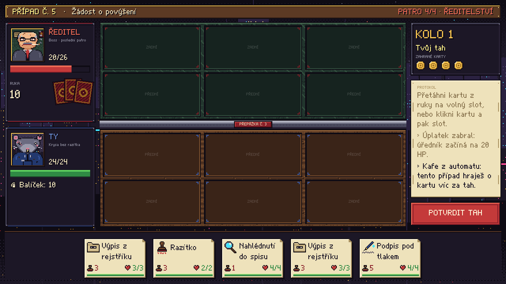

# Card Bureaucracy

2D karetní hra o byrokracii v dystopickém městě. Hraješ za krysu ze slumů, která se probíjí úřadem patro po patře. Úředníci po tobě házejí referenty a kontrolory, ty jim vracíš formuláře, razítka a stížnosti. Když dojdou peníze, prodáváš v baru vlastní ruce.



## Cíl hry

- **Výhra:** vyhraj případ na všech čtyřech patrech úřadu (Podatelna → Referát → Odbor → Ředitelství). Na posledním patře sedí ředitel (boss). Když ho porazíš, kariéra je dokončená a hra končí obrazovkou **KARIÉRA DOKONČENA**.
- **Prohra jednoho případu:** spadneš na 0 HP. Patro opakuješ, ale další pokus stojí groše.
- **Prohra celé hry:** nemáš groše na další případ a nemáš už ani ruku, kterou bys prodal. Hra končí razítkem **KONEC KARIÉRY**.

Podrobnosti jsou v [docs/design-dokument.md](docs/design-dokument.md).

## Průchod hrou

`menu` → výběr obtížnosti → šarlatán prozradí heslo → zkouška (tutoriál, nejde prohrát) → `město` → `úřad` (případ na dalším patře) nebo `bar` (černý trh) → … → ředitel → `konec`.

- **Případ (souboj):** tři pruhy, přední a zadní řada. Za tah zahraješ až 3 karty, pak úředník. Přední karty se bijí ve svém pruhu, přebytek útoku propadá dozadu, prázdný pruh znamená zásah přímo do HP.
- **Ruleta:** když začne tah s prázdnou rukou, šarlatán nabídne ruletu. Výhra jsou karty, prohra zlomené žebro (−4 max HP) nebo ruka (−1 karta za tah).
- **Město:** groše, stav krysy, kariéra (na kterém jsi patře) a úřad, kde se platí za další případ.
- **Bar U Zlaté krysy:** heslo „Jdu sem pro Honzu“ a za závěsem Honzův obchod:

| Zboží | Co dělá |
|---|---|
| Prodej ruky | +groše, ale o kartu méně za tah (max 2 ruce) |
| Protéza | vrátí kartu za tah za prodanou ruku |
| Šarlatánova mast | zahojí jedno zlomené žebro |
| Vatovaná vesta | +4 max HP natrvalo (max 2) |
| Padělané razítko | karta ÚT 4 / ŽIV 4 navíc v každém případu (max 3) |
| Úplatek | úředník dalšího případu začne o 6 HP slabší |
| Kafe z automatu | další případ hraješ o kartu víc za tah |

## Ovládání

Hra se ovládá jen myší.

| Akce | Ovládání |
|---|---|
| Zahrát kartu | přetáhni kartu z ruky na volný slot, nebo klikni na kartu a pak na slot |
| Ukončit tah | tlačítko **POTVRDIT TAH** |
| Dialog | kliknutí (nebo Enter / mezerník) posune text, volby se vybírají kliknutím |
| Město | klik na **bar** (vlevo) nebo **úřad** (vpravo dole) |
| Obchod | tlačítka **KOUPIT / PRODAT** u zboží, **ODEJÍT** zpět do města |

Zadní řadu můžeš obsadit, jen když je v pruhu obsazená přední. Volné sloty, kam jde karta položit, svítí zlatě.

## Spuštění

### Co potřebuješ

- **Godot 4.7** (standardní verze, ne .NET). Vyzkoušeno na 4.7.2: <https://godotengine.org/download>
- Git (na naklonování repozitáře).
- Python 3 s Pillow jen tehdy, když chceš přegenerovat grafiku nebo spustit simulátor balance. Ke hraní potřeba není.

### Postup

```bash
git clone <adresa-repozitáře> card-bureaucracy
cd card-bureaucracy
```

**Varianta A: přes editor (nejjednodušší).** Spusť Godot, v Project Manageru dej **Import**, vyber soubor `project.godot` a potom **Run** (F5). Editor si při prvním otevření sám naimportuje grafiku.

**Varianta B: z příkazové řádky.** Po naklonování je potřeba **jednou** naimportovat grafiku, jinak hra spadne na chybě `Identifier "UiKit" not declared`. Složka `.godot/` není v repozitáři.

```bash
godot --headless --path . --import   # jen poprvé (a po změně grafiky)
godot --path .                        # spustí hru
```

Na Windows je místo `godot` cesta k `Godot_v4.7.2-stable_win64.exe`. Na macOS je to `/Applications/Godot.app/Contents/MacOS/Godot`.

## Testy

Automatické testy herní logiky (kariéra, groše, obchod, efekty, souboj, start případu podle patra):

```bash
godot --headless --path . -s tests/test_runner.gd
```

Vypíše `N prošlo, 0 selhalo` a vrátí exit code 0. Při chybě vypíše řádky `FAIL …` a vrátí 1. I tady je nejdřív potřeba jednou spustit import (viz výše).

Ruční testovací scénář (co proklikat před odevzdáním) je v [docs/testovaci-scenar.md](docs/testovaci-scenar.md).

Balance se ověřuje simulací tisíců her, výsledky jsou v [docs/balance.md](docs/balance.md):

```bash
python3 tools/balance_sim.py          # jednotlivá patra + celá kariéra
python3 tools/balance_sim.py career   # jen celá kariéra
```

## Použité technologie

- **Godot 4.7** (renderer Compatibility), skriptovací jazyk **GDScript**. UI se staví v kódu, scény `.tscn` jsou jen kořenové uzly se skriptem.
- **Python 3 + Pillow**: veškerou pixel-art grafiku (font, rámy, karty, ikony, portréty, pozadí) kreslí skripty v `tools/`. Nic se nekreslí ručně.
- **Python 3**: simulátor balance `tools/balance_sim.py` (zrcadlí pravidla z `scripts/main.gd`).
- **Git** na správu verzí.
- **AI asistent (Claude)** jako pomocník při psaní kódu, grafiky a dokumentace. Kde pomáhal a kde chyboval, je v [docs/denik-selhani-ai/](docs/denik-selhani-ai/).

## Struktura projektu

```
scenes/        menu, main (případ), city (město), bar, ending (výhra)
scripts/       game_state.gd (autoload: groše, patra, efekty, obchod), main.gd (souboj),
               city.gd, bar.gd, menu.gd, ending.gd, roulette.gd, dialog_box.gd,
               character_portrait.gd, ui_kit.gd (sdílené UI a paleta)
assets/        vygenerovaná grafika (needitovat ručně)
tools/         gen_assets.py, gen_world.py, gen_characters.py (grafika),
               balance_sim.py (balance), screenshot.gd (snímky bez klikání)
tests/         test_runner.gd (automatické testy)
docs/          design dokument, balance, testovací scénář, deník selhání AI, retrospektiva
```

## Grafika

Pixel art v mřížce 640x360, zvětšený 2x na 1280x720.

```bash
python3 tools/gen_assets.py              # přegeneruje assets/ (potřebuje Pillow)
godot --headless --path . --import
```

Paleta je nahoře v `tools/gen_assets.py`. Ikona karty se bere z klíče `icon` v `CARD_POOL` / `ENEMY_POOL` (`assets/icons/card_<icon>.png`).

Snímek obrazovky bez klikání (volby jsou popsané v hlavičce skriptu):

```bash
godot --path . -s tools/screenshot.gd -- out=/tmp/shot.png scene=city setup=rich
```

## Tým

| Člen | Role |
|---|---|
| Pajimyr | design, programování, grafika |
<!-- Doplňte další členy týmu. Každý musí mít v gitu commity pod vlastním jménem. -->
